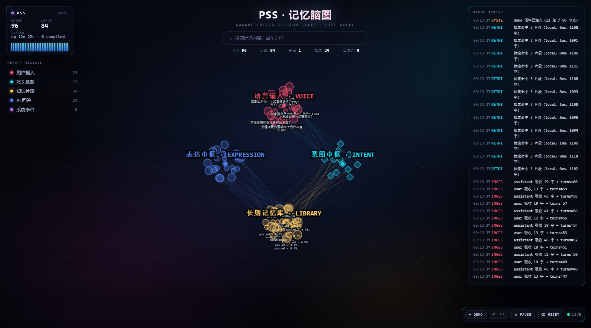

<div align="center">

# dsh-pss

**P**arameterized **S**ession **S**tate —— 用一组 LoRA 权重，替掉一整段对话历史。<br>
给 AI 装上会「记」的脑子，再给它一面能看进脑子里的镜子。

`O(1) 恒定存储` · `参数化意图` · `实时脑图探针` · `离线 LoRA 训练`

[](#路线图)
[](#自检)
[](package.json)
[](package.json)
[](LICENSE)

[](docs/galaxy.png)

*↑ 每一颗发光节点都是一次真实发生的记忆动作：红色是你打的字，青色是 PSS 收敛出的意图，黄色是被检索到的知识片段，蓝色是拼给模型的上下文包。*

</div>

---

## 它解决什么

现在的 Agent 记东西基本两条路：

| 路线 | 做法 | 代价 |
| --- | --- | --- |
| **塞进上下文** | 把历史摘要一路带着走 | prompt 随轮数线性变长，token 花在重复的话上，越长越慢越贵 |
| **向量库检索** | 历史切块、embedding、top-k 召回 | 存储线性增长；检索是「按字面相似度捞碎片」，经常捞回一堆无关旧话 |

PSS 走第三条路：**把「这段会话里这个人关心什么」压进一组 ≤ 8MB 的 LoRA 权重里**。

```
                      ┌──────────────── 一次 retrieve 的生命周期 ────────────────┐
                      │                                                        │
  用户新问题 ──────────▶ ① 加载该会话的 LoRA adapter（毫秒级热插）              │
                      │         │                                              │
                      │         ▼                                              │
                      │ ② LoRA 把「问题 + 会话质心 + 关键词」改写成检索意图      │
                      │         │      例：「那 0(1) 那块怎么做的？」            │
                      │         │      →「PSS 恒定存储 实现机制 质心 EMA」        │
                      │         ▼                                              │
                      │ ③ 意图去查 BM25 知识库 → top-k 片段                     │
                      │         │                                              │
                      │         ▼                                              │
                      │ ④ 拼成 context pack，卸载 adapter，返回给模型            │
                      └────────────────────────────────────────────────────────┘

   会话结束 ──▶ compile：把这轮 history 训进 LoRA ──▶ 下一轮直接读权重，不读历史
```

存储与上下文体积**与对话轮数无关**：第 5 轮和第 500 轮的 prompt 一样长。

> v0.2 是**工程闭环**版本：接口契约、探针、脑图、训练流水线全部真实可跑，
> 而「生成检索词的模型」默认用本地可解释的启发式实现（`intentBackend: 'local'`），
> 装上 Python 后端后切 `'lora'` 即走真实 adapter。见 [诚实边界](#诚实边界)。

---

## 三个卖点

### 1. O(1) 恒定存储 —— 对话再长，存储不增

一轮对话只改三样东西，都是定长的：

```ts
centroid:  number[32]   // 会话「关心什么」的质心向量，EMA 更新：c ← 0.78c + 0.22v
keywords:  Keyword[48]  // 带衰减权重的关键词表，老的每次 ×0.86，新的 +1
lora:      LoraRef      // 一个 adapter 引用，路径 + 状态，几百字节
```

10 轮和 10000 轮的状态文件一样大（`sessions/<id>.json`，实测 ~1.5KB）。
历史本身**不进状态**：它只在 `compile` 的时候被喂给训练器，训完即弃。

### 2. 参数化意图 —— 用权重，而不是用语法，去理解你的问题

用户说「那 0(1) 那块怎么做的？」，字面上和知识库里的「PSS 恒定存储实现」没有任何公共词。
BM25 捞不到，向量检索靠不住。PSS 的做法是让**这组会话专属的权重**把它改写成检索词：

```
输入  那 0(1) 那块怎么做的？
输出  PSS 恒定存储 状态大小 质心 EMA LoRA adapter 线性增长
```

这层改写由 adapter 完成，所以它天生带着「这个用户、这个会话」的上下文偏差 ——
同一个问题，在不同会话里会扩成不同的检索词。这是特性，不是 bug。

### 3. 极客级可视化 —— 能看见 AI 在想什么

后端每个动作都往探针里写一笔：`user → intent`（参数化因果）、`intent → knowledge`（检索命中）、
`knowledge → answer`（上下文装配）、`session → lora`（编译）。Dashboard 每 3 秒拉一次增量图，
把这些因果关系摊成一张会呼吸的星图：五个类别各自成团，团与团之间是浮在星尘上的「脑区」标题。

| 类别 | 颜色 | 形状 | 含义 |
| --- | --- | --- | --- |
| 用户输入 | `#ff5470` 红 | 圆点 | 你说的话（语言输入 · VOICE） |
| PSS 意图 | `#22e0ff` 青 | 菱形 | LoRA 改写出来的检索意图（意图中枢 · INTENT） |
| 知识片段 | `#ffcf6b` 黄 | 圆点 | 被命中的知识库 chunk（长期记忆库 · LIBRARY） |
| AI 回答 | `#5b8cff` 蓝 | 圆点 | 拼给模型的 context pack（表达中枢 · EXPRESSION） |
| 系统事件 | `#b07cff` 紫 | 六边形 | 会话创建、编译、错误（代谢 · METABOLISM） |

连线：青色 = 参数化，黄色 = 检索，蓝色 = 装配，紫色 = 编译，全部细到近乎透明 ——
它们不该抢节点的话。左上 HUD 显示节点/连线/会话/检索数和事件火花线，方向键旁的图例可按类别过滤，
右上是一直在滚的事件流，点节点看详情，顶部搜索框支持实时过滤 + 回车飞到命中簇。

**为什么不用力导向**：`cose` 会把五个类别揉成一个球，几轮下来所有边都缠在中心。
这里改成自己算坐标 —— 五个分区按圆周均匀分布，簇内成员按黄金角螺旋铺开，
位置只与「序号 + id 哈希」有关。结果是：新记忆永远出现在簇的外圈，老节点不会被重新洗牌，
图看起来是**在生长**，而不是每 3 秒重新抖一次。

---

## Quick Start

### 方式 A：只跑脑图（30 秒，不装 DSH）

```bash
git clone https://github.com/LFLmLXY/dsh-pss.git
cd dsh-pss
npm install
npm run dev          # 构建 + 起服务 + 自动灌 3 轮演示语料
```

打开 <http://127.0.0.1:8964/> 就能看到星图。
`npm run dev -- --no-demo` 不灌语料，`--port=9100` 换端口。

### 方式 B：装进 DSH

```bash
npm install
npm run build
dsh plugin add D:/path/to/dsh-pss     # 目录安装，读 package.json 的 dsh.bundle.patch
```

或者手工在 profile 的 `cordis.yml` 里挂（等价于 `cordis.patch.yml` 的内容）：

```yaml
- insert:
    - id: dsh-pss
      name: dsh-pss
      config:
        port: 8964
        autoStart: true
        seedDemo: true
        intentBackend: local
```

装好后：DSH 里每次你说一句话，插件自动 `ingest`；模型可以主动调用 `pss_retrieve` 工具拿记忆；
会话销毁时自动 `compile`。脑图照旧在 <http://127.0.0.1:8964/>。

### 方式 C：接上离线 LoRA 训练后端（可选）

```bash
cd python_backend
pip install -r requirements.txt          # 只要 API 和 dry-run：够用了
python main.py                           # → http://127.0.0.1:8077

# 想要真训练（需要 GPU + 下载 base model）：
pip install -r requirements-train.txt
PSS_DRY_RUN=0 PSS_BASE_MODEL=Qwen/Qwen2.5-0.5B-Instruct python main.py
```

然后在 DSH 配置里把训练器接上：

```yaml
      config:
        trainerUrl: http://127.0.0.1:8077     # compile 时会真的发训练任务
        intentBackend: lora                   # 检索词改由 adapter 生成
        intentBackendUrl: http://127.0.0.1:8077
```

没装 torch 也不会炸：`PSS_DRY_RUN=auto` 检测不到训练栈就自动走 dry-run，
照样写 `adapter_manifest.json` 和占位权重，把整条流水线跑通。

---

## 结构

```text
dsh-pss/
├── src/                      # DSH 插件后端（TypeScript，运行时零依赖）
│   ├── index.ts              #   插件入口：注册 pss_retrieve、挂会话事件、起 Dashboard
│   ├── PSSManager.ts         #   核心：ingest / retrieve / compile / 探针埋点
│   ├── http.ts               #   Dashboard HTTP 服务（REST + 静态资源）
│   ├── embed.ts              #   hash embedding + 分词 + BM25
│   ├── intent.ts             #   意图后端：local 启发式 / LoRA 远程 / 自动降级
│   ├── knowledge.ts          #   知识库载入与切块（内置 8 条种子语料）
│   ├── store.ts              #   状态落盘（原子写）
│   └── types.ts              #   全部类型契约（GraphData / PSSState / …）
├── dashboard/
│   ├── index.html            # 单文件星图（Cytoscape.js，深色 + 发光 + HUD）
│   └── vendor/cytoscape.min.js  # 本地 vendored，离线可用（3.30.2, MIT）
├── python_backend/           # 离线训练端（FastAPI + peft，带 dry-run）
├── knowledge/pss.md          # 可替换的知识语料
├── tool/
│   ├── dev-server.mjs        # 本地开发服务器
│   └── smoke.mjs             # 32 项自检
├── docs/galaxy.png           # 星图截图（README hero）
├── cordis.patch.yml          # DSH bundle 补丁
└── package.json
```

一行看懂的架构：

```text
   ┌──────────┐  user/assistant  ┌─────────────┐   graph delta   ┌────────────┐
   │   DSH    │ ───────────────▶ │  PSSManager │ ──────────────▶ │ Dashboard  │
   │ session  │                  │  探针 + 状态 │ ◀────────────── │  (浏览器)   │
   └──────────┘ ◀─── context ─── └──────┬──────┘   3s polling    └────────────┘
        ▲            pack               │
        │                               │ compile
   pss_retrieve                         ▼
        │                        ┌──────────────┐   POST /compile   ┌──────────┐
        └─────────────────────── │ LoRA adapter │ ◀──────────────── │ FastAPI  │
                                 └──────────────┘   getAdapter()    └──────────┘
```

---

## HTTP API

Dashboard 与插件共用同一个内置 HTTP 服务（默认只监听 `127.0.0.1`）。

| 方法 | 路径 | 说明 |
| --- | --- | --- |
| GET | `/` | 脑图页面 |
| GET | `/api/pss/health` | 健康检查：版本、知识片段数、会话数 |
| GET | `/api/pss/graph?since=N` | 全量图；`since` 命中当前版本时返回 `{unchanged:true}`（省流量） |
| GET | `/api/pss/events?since=N` | 探针事件流 |
| GET | `/api/pss/sessions` | 会话列表与各自状态摘要 |
| GET | `/api/pss/knowledge` | 知识库片段 |
| POST | `/api/pss/ingest` | `{sessionId?, role, text}` 吸收一句话 |
| POST | `/api/pss/retrieve` | `{sessionId?, query}` 跑一次完整检索，返回 context pack |
| POST | `/api/pss/compile` | `{sessionId, history?}` 触发编译（有 trainerUrl 时真发训练） |
| POST | `/api/pss/demo` | `{reset?}` 一键灌演示语料 |
| POST | `/api/pss/reset` | 清空内存图（不动落盘状态） |

```bash
curl -s localhost:8964/api/pss/health
curl -s -X POST localhost:8964/api/pss/retrieve \
     -H 'content-type: application/json' \
     -d '{"query":"那 0(1) 那块怎么做的？"}'
```

---

## 模型工具 `pss_retrieve`

插件注册给模型的工具，模型在自己觉得「可能需要长期记忆」时调用：

```jsonc
// 参数
{ "query": "用户刚问的问题", "sessionId": "可选，缺省取当前会话" }

// 返回（同时以文本形式渲染进上下文）
{
  "sessionId": "…",
  "query": "…",
  "intentQuery": "PSS 恒定存储 状态大小 质心 EMA",
  "keywords": ["PSS", "恒定存储", "…"],
  "hits": [{ "chunkId": "seed:pss-core", "source": "seed/pss-core", "score": 12.4, "text": "…" }],
  "contextPack": "【PSS 记忆 · 3 段】\n…",
  "latencyMs": 1,
  "intentSource": "local",
  "stateVersion": 12
}
```

---

## 配置

| 键 | 默认 | 说明 |
| --- | --- | --- |
| `enabled` | `true` | 总开关 |
| `root` | `~/.dsh/pss` | 会话状态目录 |
| `port` | `8964` | Dashboard 端口（被占用自动顺延） |
| `autoStart` | `true` | 插件加载时自动起 Dashboard |
| `dashboardDir` | `''` | 自定义前端目录，空则用包内 `dashboard/` |
| `dim` | `32` | 质心向量维度 |
| `topK` | `3` | 检索返回片段数 |
| `maxNodes` | `400` | 图节点上限（超出按时间淘汰最老的非锚点） |
| `knowledgeDir` | `''` | 额外知识目录（`.md/.txt`） |
| `intentBackend` | `local` | `local` 启发式 / `lora` 远程 adapter |
| `intentBackendUrl` | `http://127.0.0.1:8077` | LoRA 意图服务地址 |
| `trainerUrl` | `''` | 训练服务地址，空则编译只落盘不训练 |
| `baseModel` | `deepseek-chat` | 记录在 adapter 元信息里的基座名 |
| `autoIngest` | `true` | 自动吸收会话消息 |
| `compileOnDispose` | `true` | 会话销毁时自动编译 |
| `seedDemo` | `true` | 启动时灌一份演示图（首次打开不至于空白） |

---

## 自检

```bash
npm run typecheck    # tsc --noEmit
npm run build        # 产出 dist/
npm run smoke        # 32 项：单元 + 插件契约 + HTTP e2e
```

`tool/smoke.mjs` 不只是单测，它用一个 mock `ctx` **真的调了一遍 `apply()`**：
验证工具参数 schema、`session/event` 吸收、`session/disposed` 触发编译、`/api/pss/graph?since` 的短路、
静态目录穿越防护（`/../package.json` 必须 404）等等。

```text
  ✓ 32 项全部通过
```

---

## 路线图

- [x] PSS 运行时（EMA 质心 / 关键词衰减 / 原子落盘）
- [x] 探针与图数据模型（`GraphData` / `GraphStats`）
- [x] 星图 Dashboard（增量拉取 + 分区螺旋布局 + HUD + 事件流 + 类别过滤 + 搜索定位）
- [x] FastAPI 训练端（真实 peft 训练 + 缺栈时 dry-run）
- [x] `pss_retrieve` 工具 + DSH bundle 补丁
- [ ] 真机验证：接上 GPU 跑一轮 `Qwen2.5-0.5B` + LoRA，对比「有记忆 / 无记忆」的检索命中率
- [ ] 多会话共享 adapter（同一用户跨会话迁移质心）
- [ ] Dashboard 时间轴回放（拖一条时间线看记忆是怎么长出来的）
- [ ] 用 `cytoscape-fcose` 替换 `cose`，让大图（>200 节点）也不打架
- [ ] WebSocket 推送替代 3 秒轮询

---

## 诚实边界

这个项目不想骗 star，所以把没做到的部分写清楚：

1. **默认的「参数化意图」是启发式的**。`intentBackend: 'local'` 走的是一套可解释的关键词扩展 +
   质心加权，不是神经网络。它让整条链路今天就能跑通、能测、能看图；真 LoRA 意图需要你装 Python 端
   并训练出自己的 adapter。
2. **`compile` 默认只落盘**。没有 `trainerUrl` 时不会训练，只写状态并在图上标一个 `compile` 边。
3. **`dim: 32` 的 hash embedding 不是语义向量**。它够用来做质心漂移的可视化和粗排，
   别拿它当 sentence-transformers 用。真要语义检索，`embed.ts` 是唯一需要换掉的文件。
4. **脑图节点默认上限 400**。超过就按时间淘汰，否则浏览器先撑不住。
5. 训练端默认 base model 是 `Qwen/Qwen2.5-0.5B-Instruct`（够小、能单卡跑），换成别的只要改 `PSS_BASE_MODEL`。

---

## 贡献

最想要的三类 PR：

- **前端**：现在的力导向在 >100 节点时开始打架，欢迎换 `fcose` / 加标签碰撞避让 / 做时间轴回放。
- **训练脚本**：更省显存的 LoRA 配方（4bit + gradient checkpointing）、更好的 `corpus` 构造（现在只是把 history 平铺）。
- **意图后端**：接 OpenAI / DeepSeek / 本地小模型的 `IntentBackend` 实现，只要实现 `generate()` 一个方法。

开发流程：

```bash
npm install
npm run dev        # 改 dashboard/index.html 刷新即生效
npm run smoke      # 提 PR 前必须绿
```

约定：`src/` 里不引运行时第三方依赖（embedding 和 BM25 都是手写的，图的就是 `npm i` 之后零负担）；
Dashboard 保持**单文件 + 本地 vendored 依赖**，离线双击也能开。

---

## License

MIT © dsh-pss contributors

<div align="center"><sub>记忆不该是一段越来越长的文本，该是一组越来越准的权重。</sub></div>
